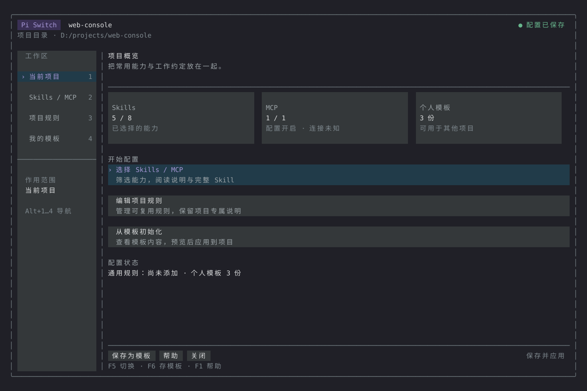
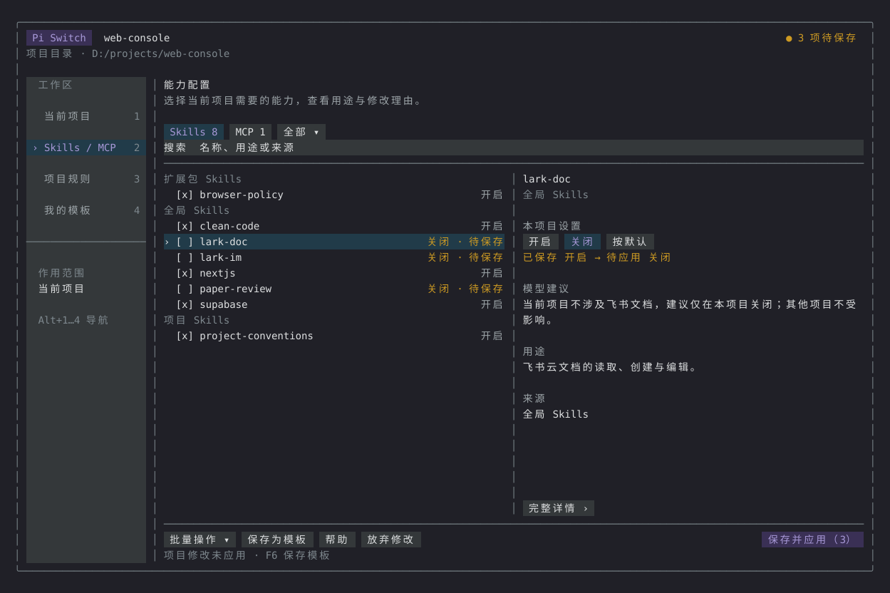
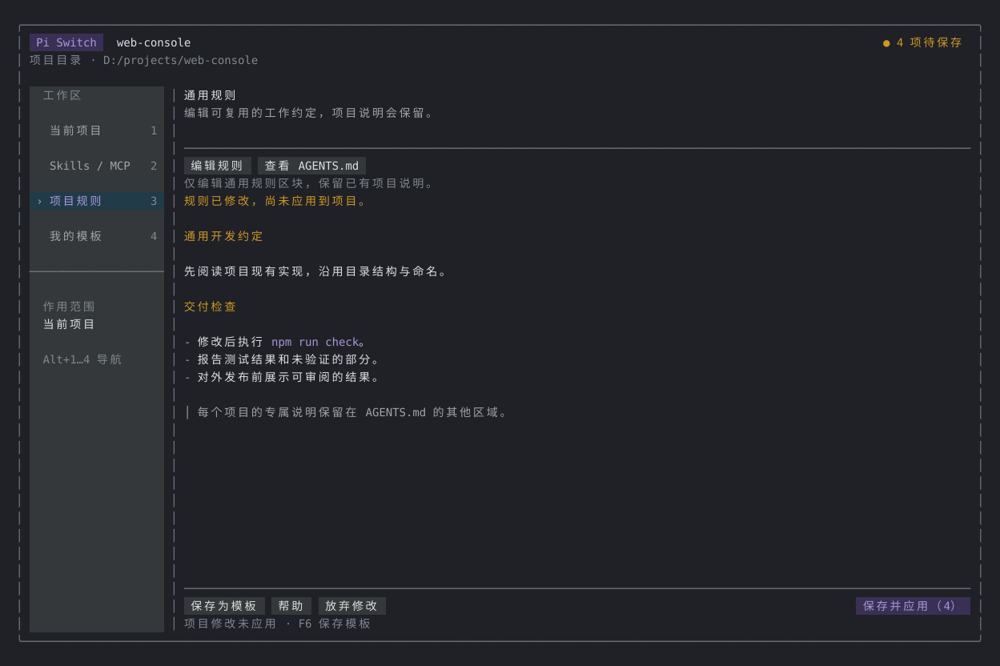
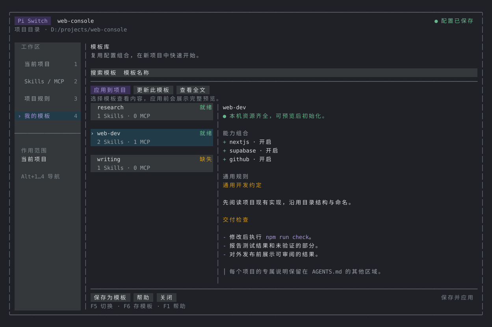

# Pi Switch · 项目工作台

在 Pi 内打开统一管理界面，选择 Skills / MCP、编辑项目通用规则、保存和应用初始化模板。也可与 Pi 当前模型对话，确认建议后直接应用。

[界面预览](#界面预览) · [安装](#安装) · [常用流程](#界面操作) · [项目模板](#项目初始化模板) · [开发验证](#开发验证)

需要 Pi **1.5.0 或更新的 1.x 版本**、Node.js **22.19.0+**；开发验证使用 Pi 1.5.0、Node.js 24。支持原生 Windows、macOS、Linux 路径。

## 安装

尚未发布到 npm，可以通过 GitHub 安装仓库中已推送的版本：

```bash
pi install git:github.com/Zenty-Me/pi-switch
```

该命令全局安装面板，方便各项目使用；面板里的开关始终只保存到当前项目。已打开的 Pi 会话执行 `/reload`，然后输入：

```text
/switch
```

仅试用一次（不写安装设置）：

```bash
pi -e git:github.com/Zenty-Me/pi-switch
```

只为当前项目安装插件：

```bash
pi install --local git:github.com/Zenty-Me/pi-switch
```

项目需要通过 Pi 原生信任流程。面板在 Pi 空闲时打开；对话建议由模型在当前任务中调用工具准备。

## 界面预览

下面的画面来自面板实际 `render()` 输出，使用示例资源和 Pi 内置主题生成，方便快速了解四个主要区域。截图中的项目名、资源和模板均为演示数据。

<table>
  <tr>
    <td></td>
    <td></td>
  </tr>
  <tr>
    <td></td>
    <td></td>
  </tr>
</table>

运行 `npm run preview` 可以重新生成同一套示例预览；它不读取本机个人资源配置，也不会连接真实 MCP 服务。

## 界面操作

输入一次 `/switch` 打开工作台，后续使用按钮即可完成配置：

| 区域 | 可以做什么 |
| --- | --- |
| 当前项目 | 查看能力数量和待保存状态，进入配置、规则和模板 |
| Skills / MCP | 搜索、筛选、勾选、批量修改；查看 Skill 全文（只读） |
| 项目规则 | 编辑 AGENTS.md 的通用规则区块，或查看完整项目文件 |
| 我的模板 | 搜索和查看模板、检查缺失资源、更新模板、初始化当前项目 |

首次打开显示“当前项目”；有暂存的模型建议时直接进入资源复核。宽窗口（至少 120 列、26 行）使用固定侧边导航，资源区域同时显示导航、列表和详情；缩窄后自动切换顶部导航和紧凑列表。导航可点击，F5 或 Alt+1…4 也可切换区域。全屏模式支持鼠标点击和滚轮，普通终端保留键盘操作。

项目概览用分区摘要展示 Skills、MCP、个人模板和待保存变更。模板列表展示资源数量及“就绪 / 缺失 / 异常”状态；规则与模板说明使用 Pi 原生 Markdown 显示标题、列表和代码。搜索框、选中项及主操作使用不同背景色，沿用 Pi 当前主题；顶部持续显示配置保存状态。

常用流程：**选择 Skills / MCP → 编辑项目规则 → 保存为模板 → 新项目打开“我的模板” → 应用到项目**。

- **保存并应用**：一起保存本项目的能力开关和通用规则，再重新加载 Pi。
- **保存为模板**：保存面板中的当前选择和通用规则，包含尚未应用的草稿；只写个人模板，当前项目修改仍待保存。
- **更新此模板**：用当前面板的能力组合和通用规则更新选中的模板，先展示完整预览。
- **应用到项目**：先查看完整配置变化，再确认初始化。有待保存草稿时先保存或放弃，不静默覆盖。
- **编辑规则**：只修改 Pi Switch 管理的通用规则区块；原有项目说明可只读查看。没有区块时从空白开始，避免把项目专属内容自动带进模板。
- **查看全文**：Skill、模板和 AGENTS.md 都有可滚动的只读全文视图。Skill 正文只用于本地显示，不进入模型工具结果或保存记录。

编辑规则、保存模板或取消预览后会回到原区域，保留项目草稿。关闭有待修改内容的工作台时，可继续编辑、保存或放弃。模板文件异常会在列表标注，规则读取异常不影响 Skills/MCP 管理。

## 项目初始化模板

通常直接通过上述界面操作。原有命令仍可作为快捷入口：

```text
/switch save web-dev
/switch init web-dev
```

`/switch save` 会打开规则编辑器，带入当前根目录 AGENTS.md（已有模板区块时只带入区块）；请删掉项目专属的路径、架构或凭据。通过界面“保存为模板”只使用“项目规则”中的通用规则草稿。留空则模板仅含能力组合。

插件按名称匹配本机已安装的 Skills、已配置的原生 MCP。应用前展示每一项开关变化及应用后的 AGENTS.md，确认后一次保存并重新加载，不调用额外模型 API。

| 命令 | 用途 |
| --- | --- |
| `/switch` | 打开统一工作台 |
| `/switch save [名称]` | 保存当前已生效的能力组合和编辑后的通用规则；不填名称时询问 |
| `/switch init [名称]` | 选择模板，预览并应用到当前项目 |
| `/switch presets` | 从个人模板列表中选择并初始化 |
| `/switch help` | 查看命令提示 |

预览支持鼠标滚轮、↑↓、PageUp / PageDown，点击底部按钮或 Enter 确认、Esc 取消。命令参数支持补全。快捷命令要求先处理待保存建议；界面允许直接将草稿保存为模板。

模板保存在 Pi 用户目录的 `switch-presets/<名称>.json`，默认是 `~/.pi/agent/switch-presets/`，遵循 `PI_CODING_AGENT_DIR`。名称支持 1–64 个英文字母、数字、横线和下划线，不允许路径或系统保留名。可以备份或手工编辑这些 JSON 文件：

```json
{
  "version": 1,
  "resources": [
    { "kind": "skill", "name": "clean-code", "enabled": true },
    { "kind": "mcp", "name": "github", "enabled": true }
  ],
  "agentsMd": "优先阅读项目现有实现。修改后运行项目检查。"
}
```

- **记录当前组合**：保存所有可编辑资源的开启/关闭选择，包含关闭项；界面保存模板时包含草稿，快捷命令保存已生效状态。只读的扩展注册 MCP 不进入模板。初始化把这些状态保存为项目设置，模板未提到的新资源保持现状。
- **引用现有资源**：模板只保存资源种类、名称和开关，不包含 Skill 文件或安装来源，也不包含 MCP 命令、URL、环境变量、密钥或登录信息。缺少资源、同名资源有歧义、资源变为只读时，整次初始化停止，不静默跳过或自动安装。
- **保护项目规则**：已有 AGENTS.md 的手写内容保留，在 `<!-- pi-switch:preset:start -->` / `<!-- pi-switch:preset:end -->` 之间管理模板内容。再次应用只更新该区块；不含规则的模板会移除旧模板区块。完全相同的模板重复应用不写文件、不重载。
- **预览与保存一致**：模板、项目或全局配置、AGENTS.md 在预览后被外部修改会中止应用。存在 AGENTS.override.md 时，拒绝应用 AGENTS.md 规则，避免写入后被 Pi 忽略。模板和规则文件不接受符号链接、目录或超过大小限制的文件。
- **一次保存**：AGENTS.md 与 Skills/MCP 配置一起写入；普通 I/O 错误会尝试恢复原内容。进程崩溃或断电仍不具备跨文件事务保证。模板已应用但重载失败时，已保存文件保留，可手动 `/reload`。

每份模板最多 2000 项资源，规则文本最多 64 KiB，读取文件上限 1 MiB。跨机器复制模板后，需要先安装对应 Skills、配置同名 MCP；资源匹配不依赖旧机器的绝对路径。模板中的通用规则文本按编辑器内容原样保存，请自行保留适合复用的内容。

## 与模型对话管理模板

可以直接告诉 Pi：

> 帮我做一个 Next.js + Supabase 开发模板，名称 web-dev。先列出已安装的 Skills 和 MCP，选择适合的能力并起草通用规则。展示完整方案，等我确认后只保存模板，不应用项目。

模型会暂存模板草稿；你可以继续说“保留浏览器”“去掉飞书”“规则里加上运行检查”。调整后需要重新确认。回复“确认保存模板”后，模型直接保存，模板会出现在“我的模板”中，无需复制规则或手工编辑 JSON。

需要使用时再说：

> 预览把 web-dev 模板应用到这个项目，会修改哪些配置？

模型展示资源设置和通用规则后，回复“确认应用”，会保存项目配置并在本次回复结束后重载。**保存模板与应用项目是两次不同的操作，保存确认不会自动授权应用。**

模型继续使用同一个 `pi_switch` 工具：

| 操作 | 用途 |
| --- | --- |
| `list / stage / apply` | 原有项目能力清单、建议和确认应用 |
| `preset_list` | 分页查看已有模板及当前模板草稿 |
| `preset_show` | 查看命名模板；不传名称时查看当前草稿，资源和规则独立分页 |
| `preset_stage` | 新建或修改模板草稿，传 `name`、可选资源 `changes` 和 `agentsMd` |
| `preset_save` | 用最新 `proposalId` 确认保存模板，不修改项目、不重载 |
| `preset_preview` | 按已保存模板生成当前项目的应用预览 |
| `preset_apply` | 用预览的最新 `proposalId` 确认应用，回复后重载 |
| `preset_discard` | 按 `proposalId` 丢弃当前模板草稿，不删除已保存模板 |

- **新建**：从空模板开始，只记录模型明确选择的资源；要保存当前整套组合，模型应分页读取清单后明确加入需要保留的条目。
- **修改**：同名草稿优先，其次同名已保存模板。`changes` 中的 `on/off` 设置模板条目，`inherit` 将该条目从模板移除；未提及条目保留。
- **规则**：`agentsMd` 替换模板规则；省略或 `null` 保留已有规则，空字符串清空。新模板不会自动读取或收录项目专属 AGENTS.md 正文。
- **完整复核**：模型必须读完资源分页及规则文本分页，展示操作类型、名称、覆盖提示、资源设置和全部规则，再等待后续消息确认。工具检查方案版本、保存/应用类型及用户消息边界；自然语言确认仍由当前模型判断。
- **界面衔接**：打开 `/switch` 时，当前模板草稿会显示在“我的模板”，标记为“草稿”，可点击“复核并保存模板”或“复核并应用”。模板草稿不会提前改动项目开关。
- **冲突与隔离**：模板或项目配置变化会使草稿失效；切换项目、会话、对话分支或重载会清除未保存的模板草稿。模板草稿不额外写入插件的会话保存记录；已展示的规则仍会存在于对话工具结果中。
- **项目草稿**：保存模板不会应用或丢弃已有项目能力建议；应用模板前需处理这些待修改项。模板没有记录的能力保持项目现状。

对话操作不自动安装资源、配置 MCP 连接、导出密钥或执行模板中的指令。查看模板时，模型应把规则内容作为待审阅数据处理。

## 方式一：对话建议，确认后应用

在当前 Pi 会话直接说：

> 这是 Next.js + Supabase 项目，不涉及飞书和论文。帮我筛选 Skills 和 MCP：保留相关能力，给出禁用建议和理由，不确定的先不要动。先给建议，等我确认后再应用。

模型使用插件提供的 `pi_switch` 工具：

1. `list`：分页读取资源名称、描述、来源分类和项目设置，获取准确资源 ID。
2. `stage`：暂存带理由的建议，返回本版方案的 `proposalId`。未提及的资源保持不变，不写配置。
3. 模型展示完整方案，包括名称、设置变化和理由。你可以说“GitHub 保留”“浏览器也会用”，模型更新建议后再次等待确认。
4. 你回复“确认应用”“就按这个方案来”等明确执行指令后，模型调用 `apply`，使用当前方案的 `proposalId` 直接保存；无需固定口令或再打开面板。
5. 如果明确说“只应用其中飞书相关项”，模型给 `apply` 传入对应 `ids`，只保存这部分。未应用建议继续保留，部分应用后的自动重载会恢复剩余建议。
6. 保存后，Pi 在当前回复结束、运行完全空闲时自动重载。保存结果与重载结果分别报告；重载失败时可执行 `/reload` 或重启 Pi。

**建议不等于应用。** 询问或要求修改建议不算确认；更新后的方案需重新确认。插件要求先暂存方案，且在后续用户消息中确认，不能同一轮 `stage` 后立即 `apply`。`apply` 只接受最新方案版本及可选的待应用资源 ID，不能夹带新设置；配置文件在外部变化后旧方案失效，必须重新读取、展示并确认。

确认语义由当前模型判断，插件校验方案版本及用户消息边界，不另调模型解释确认语句。这不是限制其他通用工具的权限沙箱；模型应通过 `pi_switch` 应用，不绕过插件编辑配置。你也随时可以输入 `/switch`，在面板查看、调整或保存暂存建议。

复用 Pi 当前会话和当前模型，不需要另配 API，不新增分类模型请求。工具返回的元数据会进入当前模型上下文；不会返回 Skill 正文、MCP URL、启动命令、请求头、环境变量或认证配置。内部配置快照不会放进工具结果或会话记录。模型可能按你的要求使用 Pi 原有工具查看项目 README 等信息。

未保存建议通常只在当前扩展运行时的内存中。切换项目／会话、切换对话分支、普通重新加载或退出 Pi 会清除建议。部分应用时，插件将剩余条目的资源 ID、目标设置、理由和配置指纹放入当前会话的保存记录，用于接下来的重载恢复；不保存配置原文。恢复前检查项目、会话及配置指纹，条件变化就放弃剩余建议，已保存修改不受影响。

## 方式二：手动管理

面板按全局、项目、扩展包等来源分组，可搜索名称、用途或来源。

宽窗口采用**左列表、右详情**：列表只突出资源名称、开启／关闭和待保存标记；右侧直接展示项目设置、模型建议和用途。窄窗口自动切换单栏，通过“详情”查看完整内容。颜色跟随 Pi 主题，选中行和主操作有底色，同时保留文字和选择箭头，不只靠颜色区分状态。

- **全部 / 项目单独设置 / 待保存**：点击筛选入口打开选择菜单，或按 F2 循环切换。“项目单独设置”是有独立项目开关的条目；“待保存”是本次尚未应用的改动。
- **批量操作**：点击底部入口或按 F4，再选择全部开启、关闭或按默认。菜单明确显示影响数量，只作用于当前标签页的全部筛选结果，包含滚动区外的条目。跳过只读项，不改变另一个标签页。
- **点击整行**：只选中条目，避免查看时误切换；点击复选框或所选项的设置才修改开关。
- **按默认**：与原来的“继承”含义相同，移除该项的项目开关，回到 Pi 原生默认／上层配置规则，不等同于一律开启。
- **详情**：宽窗口可直接阅读和滚动右侧内容；按 F3 或点击详情入口查看完整描述、建议理由和设置差异。
- **已保存 → 待应用**：仅在修改后突出展示变化；没有修改时显示当前状态，减少重复信息。
- **撤销全部待保存**：在批量菜单中恢复 Skills、MCP 和通用规则的全部草稿，不撤销以前已保存的配置。
- **保存并应用（数量）**：唯一主按钮；没有修改时不可点击。完整快捷键说明放在“帮助”中，不再常驻占用列表空间。

| 操作 | 按键 |
| --- | --- |
| 切换四个区域 | F5；Alt+1 / 2 / 3 / 4 |
| 保存当前选择为模板；更新选中模板 | F6；F7（我的模板区域） |
| 编辑通用规则 | Ctrl+E / Enter（项目规则区域） |
| 切换 Skills / MCP | Tab（资源区域） |
| 搜索；清空搜索 | 直接输入；Ctrl+U |
| 帮助 | F1 |
| 切换全部 / 项目单独设置 / 待保存 | F2 |
| 查看资源、项目文件或模板全文 | F3；Esc 返回 |
| 打开批量操作菜单 | F4 |
| 选择条目；翻页 | ↑ / ↓；PageUp / PageDown |
| 切换所选项启用状态 | 空格 / Enter |
| 所选项按默认 | Ctrl+R |
| 批量开启 / 关闭 / 按默认 | Alt+E / Alt+D / Alt+R |
| 保存全部待修改项并重新加载 | Ctrl+S |
| 关闭面板 | Esc |

全屏模式支持鼠标点击按钮、复选框和滚轮操作；普通模式使用键盘。`[x]` 表示开启，`[ ]` 表示关闭，修改项用“待保存”明确标记。关闭时有待修改项会弹出确认，可继续编辑、保存或放弃。

建议终端至少 40 列、20 行；120 列以上可展示侧边导航，144 列 × 38 行能同时舒适阅读资源与说明。字体、字号和字形由终端设置决定。

## 配置、继承与 MCP 边界

- Skills 使用 Pi 原生 `.pi/settings.json` 的精确资源路径开关与包级覆盖。兼容全局、项目、`.agents/skills` 和已安装包中的 Skills；禁用项仍可见，可重新启用。
- MCP 使用项目 `.pi/mcp.json` 的 `enabled` 字段。禁用全局服务只写 `{ "enabled": false }` 覆盖，不复制全局命令、URL、密钥等配置。
- 恢复 MCP 继承仅去掉项目 `enabled`，保留服务定义和暴露设置。恢复 Skills 继承移除单项精确开关，保留已有目录／通配符策略。
- 项目开关只在对话确认后的 `apply`、面板保存或模板初始化预览确认后写入，不改全局资源配置，不移动或删除 Skills，不修改 Pi 核心。`/switch save` 另外写入用户目录下的个人模板。对话应用会在回复结束后自动重载；面板和模板应用后立即重载。加载失败时提示手动 `/reload`。
- 保存前检查项目和全局配置是否变化；单文件通过临时文件替换。多文件保存遇普通 I/O 错误会尝试恢复原文件；进程崩溃或断电不具备跨文件事务保证。
- **MCP 的配置启用不代表连接成功。** 当前连接状态显示“未知”，诊断和登录请用 Pi `/mcp`，不伪造连接结果。
- 只管理 **Pi 原生 `mcp.json` 服务**。扩展临时注册的 MCP 只读；第三方 MCP 适配器的专用配置由其自身管理。浏览器、搜索、子代理等普通扩展工具不是原生 MCP 服务。

没有原生 MCP 时，该标签页为空，可先用 `pi mcp add` 添加。不同路径的同名 Skills 分别显示，实际优先级由 Pi 决定。新资源仍沿用 Pi 默认规则，不自动加入禁用名单。重新加载只影响后续请求，已进入对话历史的 Skill 内容或 MCP 结果仍可能保留。

## 更新、迁移、卸载

v0.4.0 统一改名为 **Pi Switch**，面板入口 `/switch`、模型工具 `pi_switch`，不保留旧命令或工具别名。旧版用户先用 `pi list` 查看并移除旧安装来源，再通过本页的新仓库地址安装，避免两份插件重复加载；已保存的项目开关不需要迁移。

更新未固定版本的已安装插件：

```bash
pi update --extensions
```

新电脑安装 Pi 后，用相同 GitHub 命令安装插件即可。也可复制插件目录并运行 `pi install /path/to/pi-switch`；只需 `package.json`、`src/`、`README.md`、`LICENSE`，不用复制 `node_modules`，无需构建。

Skills、MCP 服务和登录信息需在新电脑分别安装或配置。已保存的项目开关仍使用 Pi 原生本机路径；可以复制 `switch-presets/` 中的模板，在新电脑通过 `/switch init` 按资源名称重新生成项目开关。

卸载 GitHub 安装的插件：

```bash
pi remove git:github.com/Zenty-Me/pi-switch
```

本地路径安装的插件使用原路径卸载。卸载后已保存的项目开关仍有效，可通过 `pi config --local` 和 `/mcp` 管理。

## 开发验证

建议使用 Node.js 24。克隆后安装开发依赖及仅供验证的宿主模块：

```bash
git clone https://github.com/Zenty-Me/pi-switch.git
cd pi-switch
npm ci --ignore-scripts
npm install --no-save --package-lock=false @earendil-works/pi-coding-agent@1.5.0 @earendil-works/pi-tui@1.5.0 typebox
npm run check
```

本地试用：

```bash
pi -e .
```

本地试用时只加载一份 Pi Switch，避免与已安装版本重复注册。

运行时只使用 Pi 提供的模块，无额外运行依赖。测试覆盖原生资源加载、项目隔离、MCP 凭据保留、配置冲突、对话建议到人工确认应用、部分应用后重载恢复、重载失败提示、面板保存，以及搜索、批量操作、键鼠交互和窄窗口布局。模板测试还覆盖对话生成/修改/保存/应用、确认类型与版本、长规则分页、会话隔离、文件锁期间新消息、界面草稿复核、跨项目原生 Skill 加载、规则区块保留与幂等更新、缺失/同名资源、取消、文件变更、三文件写入回滚和命令入口。不调用外部模型 API，也不连接真实 MCP 服务；模型推荐和自然语言确认的质量仍需实际使用评估。

可通过 `npm run preview` 生成四个工作区、暗色/浅色主题、窄窗口和批量菜单的视觉预览，输出到系统临时目录。预览直接使用面板的实际 `render()` 结果及 Pi 内置主题，只含示例资源，不读取个人资源配置；它不是运行中的终端截图，也不会作为插件运行时加载。
